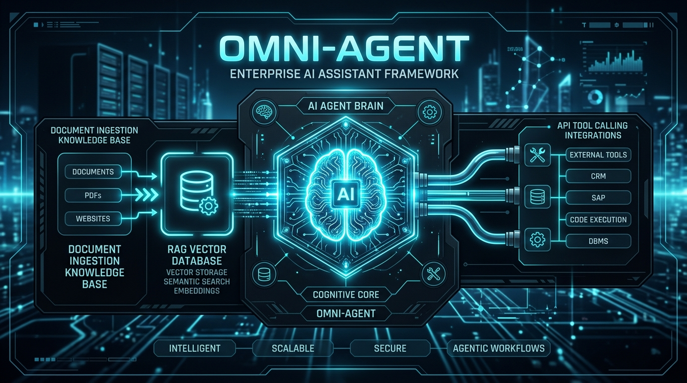
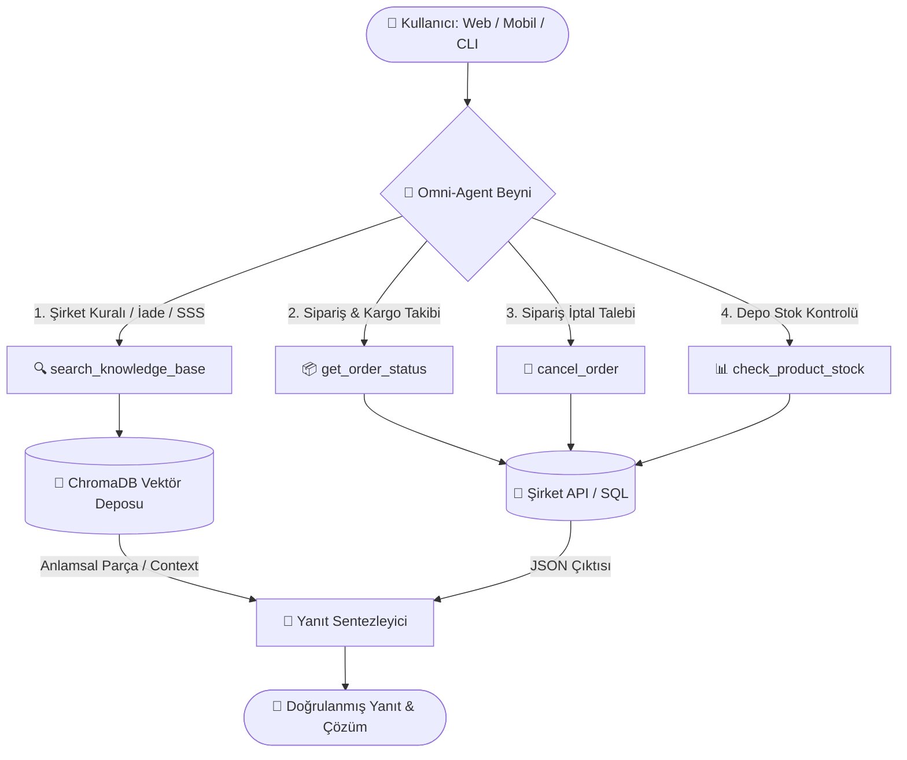

<div align="center">



# 🚀 Omni-Agent Engine
### Tak-Çalıştır Kurumsal Yapay Zeka Asistanı & Agentic RAG Framework

[](https://www.python.org/)
[](https://www.trychroma.com/)
[](https://aistudio.google.com/)
[]()
[]()

*Şirketlerin, web sitelerinin ve mobil uygulamaların kendi dokümanlarıyla konuşmasını, veritabanı ve harici API'ları güvenle çalıştırmasını sağlayan modüler, açık kaynaklı yapay zeka omurgası.*

</div>

---

## 📌 Bu Proje Neden Yapıldı? (Problem & Çözüm)

Standart bir yapay zeka modelini (ChatGPT veya Gemini) olduğu gibi alıp bir şirketin veya uygulamanın önüne koyduğunuzda iki büyük kriz yaşanır:

1. **Halüsinasyon ve Özel Veri Eksikliği:** Model şirketinizin dünkü iade şartlarını, stok adedini veya kargo anlaşmasını bilmez. Bilmediği zaman özgüvenle uydurur.
2. **Eylemsizlik (Eli Kolu Bağlı Olma):** Standart model sadece metin yazar; veritabanına gidip kargo sorgulayamaz, sipariş iptal edemez veya API tetikleyemez.

> **💡 Wix / Shopify Yapay Zekalarının Sırrı Nedir?**  
> Wix veya Shopify panellerinde gördüğünüz *"PDF'inizi yükleyin, yapay zekanızı eğitin"* özelliği arkada modeli baştan eğitmez. Arka planda **RAG (Retrieval-Augmented Generation)** çalıştırır.  
> **Omni-Agent**, bu RAG mimarisini bir adım öteye taşıyarak modele **Tool Calling (API ve Veritabanı Çağırma)** yeteneği kazandırır.

---

## 🏗️ Sistem Mimarisi

Aşağıdaki şemada Omni-Agent'ın bir kullanıcı sorusunu nasıl analiz ettiği ve uygun aracı nasıl seçtiği gösterilmektedir:



---

## 📂 Proje Klasör Yapısı

Proje tamamen **tak-çalıştır ve sürdürülebilir** şekilde modüllere ayrılmıştır:

```text
Deneyim/
├── 📂 knowledge_base/        # 📄 EĞİTİM ALANI: Buraya istediğiniz PDF, TXT veya MD dosyalarını atın
│   ├── company_policy.txt    # Örnek şirket politikaları
│   └── sikca_sorulan_sorular.md # Örnek SSS metni
│
├── 📂 custom_tools/          # 🔌 API BAĞLAMA ALANI: Tak-çalıştır fonksiyonlar
│   ├── registry.py           # Otomatik OpenAI/Gemini şema üretici
│   ├── orders.py             # Sipariş sorgulama, iptal ve stok kontrol API'ları
│   └── knowledge_tool.py     # Agentic RAG aracı
│
├── 📂 src/                   # 🧠 ÇEKİRDEK MOTOR (Framework Core)
│   ├── config.py             # Ortam değişkenleri ve model sağlayıcı yönetimi
│   ├── embeddings.py         # Yerel ve çevrimdışı çalışan güvenli embedding motoru
│   ├── vector_store.py       # ChromaDB arama motoru
│   ├── agent_engine.py       # ReAct (Reasoning + Acting) Agent döngüsü
│   └── mock_engine.py        # API anahtarsız test simülatörü
│
├── 📂 tests/                 # 🧪 OTOMATİK TESTLER
│   └── test_agent.py         # Tüm yetenekleri otomatik doğrulayan test senaryosu
│
├── ingest.py                 # 🚀 "EĞİT" KOMUTU (Tek tıkla tüm dökümanları vektörleştirir)
├── main.py                   # 💬 ÇALIŞTIRMA KOMUTU (Etkileşimli CLI asistanı)
├── requirements.txt          # Gerekli kütüphaneler
└── README.md                 # Proje dokümantasyonu
```

---

## ⚡ Hızlı Başlangıç (3 Adımda Çalıştırın)

### 1. Kurulum ve Ortam Hazırlığı
Terminalde proje klasörünü açın ve bağımlılıkları yükleyin:
```powershell
# Sanal ortamı oluşturun ve aktif edin
python -m venv .venv
.venv\Scripts\Activate.ps1

# Kütüphaneleri kurun
pip install -r requirements.txt
```

### 2. Bilgi Tabanını İndeksleyin (Yapay Zekayı Eğitin)
`knowledge_base/` klasörüne kendi belgelerinizi koyun ve tek komutla veritabanını oluşturun:
```powershell
python ingest.py
```
*Çıktı:*
```text
✓ Toplam 11 parça başarıyla vektörleştirildi ve kaydedildi!
Yapay zeka artık bu dökümanlardaki tüm sorulara RAG ile cevap verebilir.
```

### 3. Asistanı Başlatın
```powershell
python main.py
```

---

## 🔌 Kendi API veya Fonksiyonunuzu Nasıl Bağlarsınız?

Projeye yeni bir yetenek kazandırmak yalnızca 5 satır koddur! `custom_tools/` klasöründe yeni bir dosya oluşturup `@register_tool` eklemeniz yeterlidir:

```python
from custom_tools.registry import register_tool

@register_tool(
    name="get_weather",
    description="Verilen şehrin güncel hava durumunu sorgular.",
    parameters={
        "type": "object",
        "properties": {
            "city": {"type": "string", "description": "Şehir adı (Örn: 'İstanbul')"}
        },
        "required": ["city"]
    }
)
def get_weather(city: str):
    # Buraya kendi harici REST API çağrınızı veya SQL kodunuzu yazın
    return {"city": city, "durum": "Güneşli", "derece": "22°C"}
```
> **Otomatik Entegrasyon:** Siz bu kodu yazdığınız anda Omni-Agent aracı tanır. Bir kullanıcı *"İstanbul'da hava nasıl?"* dediğinde arka planda bu fonksiyonu otomatik olarak çalıştırır!

---

## 🔒 Güvenlik Mimarisi (Kurumsal Standartlar)

Şirketlerin özel API'ları yapay zekaya açıldığında güvenliği şu katmanlarla sağlarız:

1. **Zero-Trust Model:** Yapay zeka veritabanı şifrelerini veya gizli API anahtarlarını asla görmez. Model yalnızca çağırmak istediği fonksiyonun adını ve parametrelerini söyler. İsteği güvenli sunucu kodumuz icra eder.
2. **Schema & Input Validation:** Prompt Injection ataklarına karşı modelden gelen tüm argümanlar katı veri tipleriyle doğrulanır.
3. **İş Kuralı Doğrulaması:** Teslim edilmiş bir sipariş iptal edilmek istendiğinde (`cancel_order`), iş kuralı devreye girer ve işlem güvenle reddedilir (`tests/test_agent.py` test 3).
4. **Human-in-the-Loop:** Kritik ve geri dönülmez işlemlerde (para iadesi vb.) doğrudan işlem yapmak yerine son onay kullanıcıya bırakılır.

---

## 🔑 Model Seçenekleri (.env Ayarları)

Omni-Agent **3 farklı modda** çalışabilir:

* **1. Simülasyon / Mock Modu (Varsayılan):**  
  Herhangi bir API anahtarı girmeden sistemi 0 TL maliyetle test edebilir, kod akışını inceleyebilirsiniz.
* **2. Google Gemini (Önerilen Canlı Mod):**  
  [Google AI Studio](https://aistudio.google.com/app/apikey) adresinden ücretsiz anahtarınızı alın ve `.env` dosyasına ekleyin:
  ```env
  DEFAULT_PROVIDER=gemini
  GEMINI_API_KEY=AIzaSy...
  ```
* **3. OpenAI:**  
  ```env
  DEFAULT_PROVIDER=openai
  OPENAI_API_KEY=sk-...
  ```

---

## 🧪 Otomatik Testleri Çalıştırma

Tüm yeteneklerin (Sipariş sorgulama, iptal, stok, RAG arama) çalıştığını tek seferde doğrulamak için:
```powershell
python tests/test_agent.py
```

---

## 🎓 Mülakatlar İçin Temel Kavramlar Sözlüğü

| Kavram | Ne Anlama Gelir? | Neden Önemli? |
| :--- | :--- | :--- |
| **RAG** | Retrieval-Augmented Generation | Modeli baştan eğitmeden şirketin güncel PDF ve belgelerinden sıfır halüsinasyonla cevap üretmesini sağlar. |
| **Vector DB** | ChromaDB, Pinecone, Qdrant | Kelime eşleşmesi yerine cümlenin "anlamını" arayan yüksek performanslı veritabanı. |
| **Tool Calling** | Function Calling | Yapay zekaya konuşmanın ötesinde harici API'ları ve SQL sorgularını tetikleme gücü verir. |
| **Agentic Workflow** | ReAct (Reasoning + Acting) | Modelin *"Bu soruyu çözmek için önce şu aracı çağırmalıyım, gelen sonuca göre de bu cevabı vermeliyim"* şeklinde mantık kurmasıdır. |

---

<div align="center">
Geliştirici dostu, modüler ve üretime hazır yapay zeka çözümleri için tasarlanmıştır. 🚀
</div>
